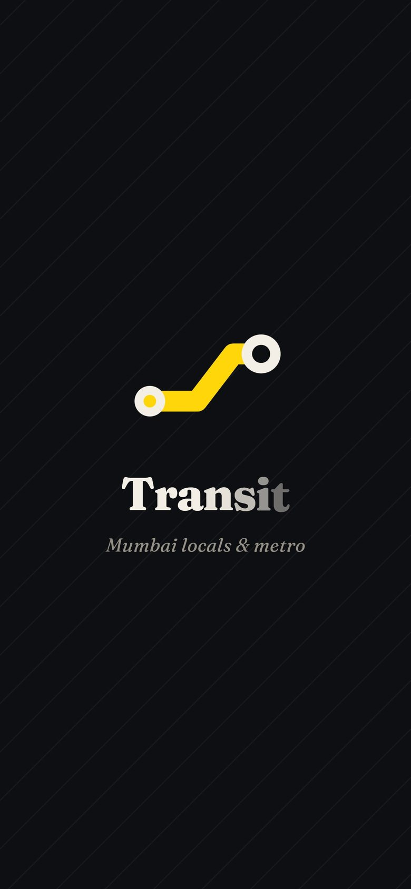
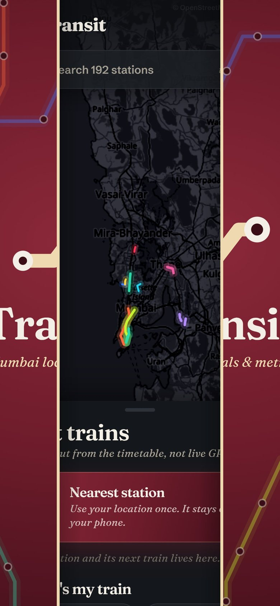
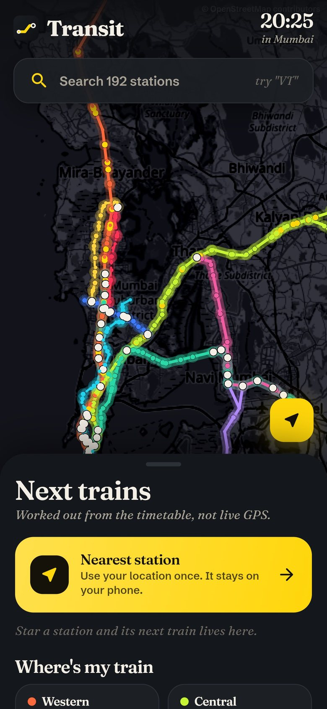
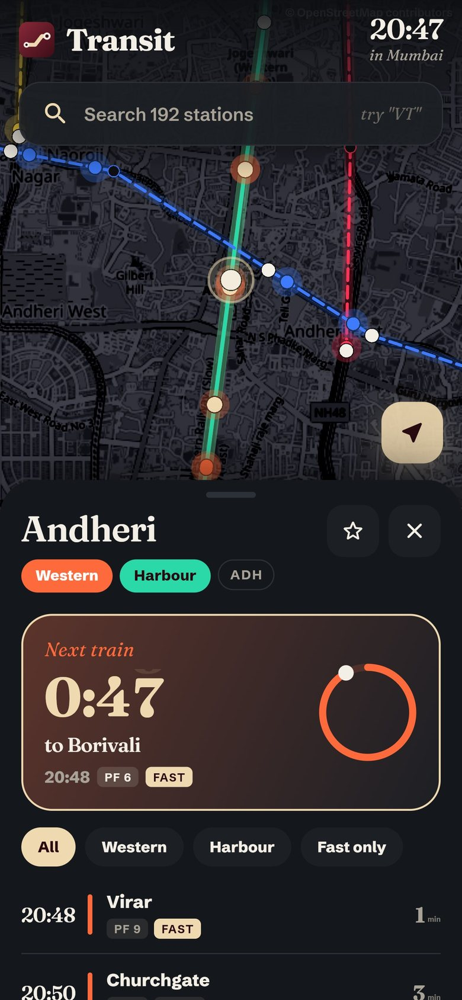
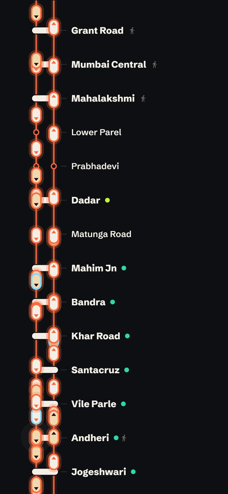
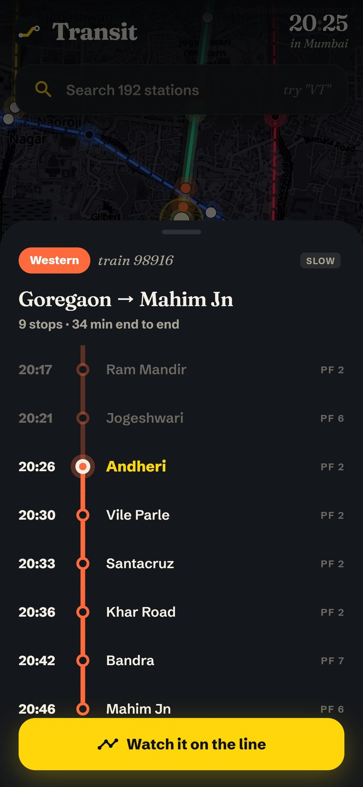
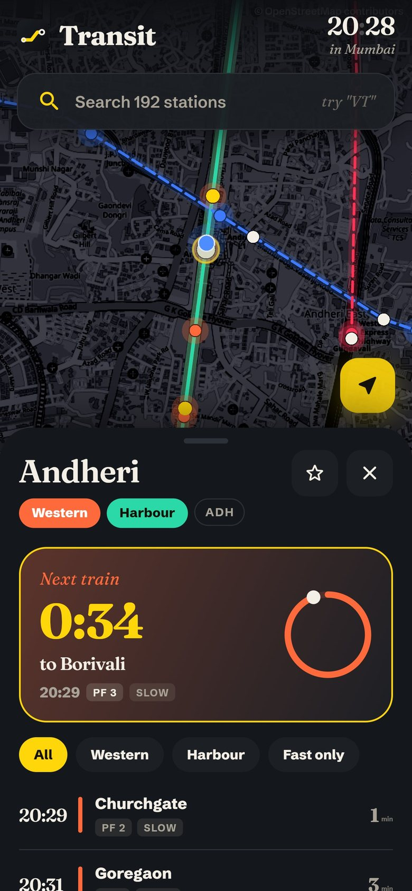
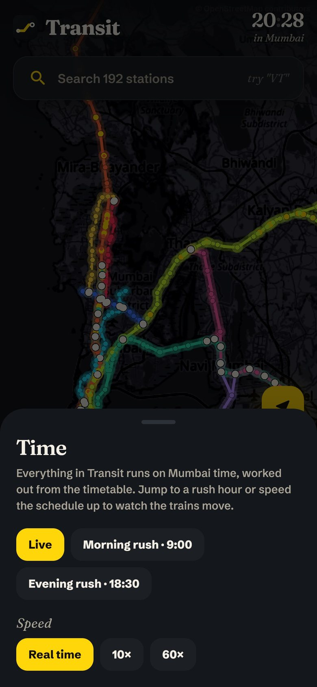

<p align="center"></p>

<h1 align="center">Transit</h1>

<p align="center"><b>Every Mumbai local and metro, in your pocket and offline.</b><br>A Flutter companion for the Western, Central, Harbour, Trans-Harbour and Uran lines and four metro lines: next-train countdowns, a night map where every train glides along its line, and a "where's my train" view drawn like a station diagram.</p>

<p align="center">
  <a href="https://alok-kul5.github.io/transit-mumbai/"><b>Open the live demo</b></a> (best at phone width) · <a href="https://github.com/alok-kul5/transit-mumbai/releases/latest/download/transit-arm64.apk"><b>Android APK</b></a>
</p>

[](https://github.com/alok-kul5/transit-mumbai/actions/workflows/ci.yml)


<p align="center">
  
  
  
  
</p>
<p align="center">
  
  
  
  
</p>

> **Not live GPS.** Mumbai has no open real-time feed for the locals or the metro, so every countdown and every train on the map is worked out from the timetable, on the phone. The app says so on the home sheet, on every line view and here. A late train will not show as late.

## Motion

Motion was designed before the screens, with one set of tokens (`lib/brand/tokens.dart`): fast ease-outs, a slight overshoot for springy things, and near-zero durations when the system asks for reduced motion.

| Moment | What happens |
|---|---|
| **Load** | On local-train maroon, the network draws itself as a line diagram, each line in its own colour with a stagger, and a cream train runs down every line. The mark draws in the middle, the wordmark rises letter by letter, and the lines step back so it reads. Then the screen slides open from the centre like a local's doors, a cream edge on each, onto the map. The web loading screen, the Android launch screen and the app icon share the maroon, so nothing flashes. Tap to skip to the doors. |
| **The map wakes up** | As the splash opens, the camera flies in from the whole region to the city, every line draws itself out from its terminus, the stations appear and the trains start to move. The sheet and top bar rise into place. |
| **Fly to a station** | Pick a station on the map or in search and the camera flies like a plane, rising for long hops and settling just above the sheet, where a cream pulse marks it. The sheet cross-fades from the overview to the station's board. |
| **Countdown** | The next train's minutes and seconds roll like a platform indicator, an approach ring closes as it gets nearer, and the card's edge lights up in cream inside two minutes. "Now" pulses when the train is due. |
| **Trains on the map** | Every running train is a solid dot in its line's colour (fast trains in cream), redrawn about 15 times a second, easing out of a station, cruising, and braking into the next. |
| **Where's my train** | The line tile grows into a full-bleed header in the line's colour. Both tracks draw down the screen, station names stagger in (interchanges as white bars across both tracks), and the trains glide along: down trains on one track, up trains on the other, fast trains in cream, AC rakes with a blue outline, ladies specials with a pink light. Tap one to open its run. "Watch it on the line" from a train scrolls to it and rings it. |
| **Time travel** | Tap the clock in the corner to jump to the morning or evening rush, or run the schedule at 10× or 60×, so you can watch the 9 am crush on the Western line at any hour. The italic line under the clock turns cream and says what you are looking at. |

## Features

- **Lines**: Western (Churchgate to Dahanu Road), Central (CSMT to Kasara and Khopoli), Harbour (CSMT to Panvel and Goregaon, and Goregaon to Panvel), Trans-Harbour (Thane to Panvel and Vashi), Uran, and Metro 1, 2A, 3 (Aqua) and 7.
- **Timetables bundled**: 3,312 suburban trains with every stop, time and most platforms, about 580 KB of JSON. Nothing is fetched except map tiles, so the boards work in a tunnel.
- **Next trains**: a departure board for any station with live countdowns, filters by line and fast only, platform numbers, and trains that end at the station left out (you cannot board them). Late at night it looks across midnight, both ways.
- **Fast, slow, AC, ladies**: from the timetable. AC and ladies rakes that run as ordinary trains at the weekend are shown as ordinary on those days.
- **Station search**: by name, by part of a word, by code (`ADH`) or by alias (`VT`, `Bombay Central`). Every word must match, and the matching part lights up in cream.
- **Favourites**: star a station and its next train lives on the home sheet. Saved on the device.
- **Nearest station**: one location fix, on request. The app finds the closest stations with a walking time and flies to the nearest. The position is never stored or sent anywhere.
- **Interchanges**: metro stations within a short walk of a suburban station (Andheri, Ghatkopar, Churchgate, CSMT, Marol Naka, ...) link to each other.
- **Mumbai time everywhere**: the clock is IST whatever the phone's time zone, so the web demo is right from anywhere.
- **Accessibility**: buttons carry labels, and all motion respects *reduce motion*.

## Data

| What | Source | Licence |
|---|---|---|
| Suburban timetable (stations, trains, stops, times, platforms, fast/AC/ladies) | The [Rush Hour](https://github.com/SphericalKat/rush-hour) project by Amogh Lele, which parses the official Western Railway and Central Railway timetable PDFs into SQLite. Pinned to commit `e78b049`. | MIT |
| Metro stations, their order and coordinates | [OpenStreetMap](https://www.openstreetmap.org/copyright) route relations for lines 1, 2A, 3 and 7, via the Overpass API | ODbL, © OpenStreetMap contributors |
| Metro service hours and frequencies | Operators' published typical frequencies (late 2026). The app generates trains from them and labels every metro time **EST**. | n/a |
| Map tiles | [OpenStreetMap](https://www.openstreetmap.org/copyright) standard tiles, tinted at night in the app | ODbL, © OpenStreetMap contributors |

`tool/build_data.py` turns these into `assets/transit.json`. The Rush Hour line order is not geographic, so the tool writes each line out as branches of station codes and checks them against the database: every station must sit on a branch, and every train is matched to the branch its stops fall on (12 of 3,324 that fit no branch are dropped). Downloads are cached in `tool/.cache`.

```
py -3.11 tool/build_data.py
```

The map uses the public OpenStreetMap tile servers under their [usage policy](https://operations.osmfoundation.org/policies/tiles/): the app identifies itself (`dev.alok.transit`), shows the attribution on the map, never prefetches or bulk-downloads tiles, and keeps traffic to a demo's worth. A busier deployment should move to its own tile server or a provider.

## How positions are worked out

A train's timetable gives a departure time at each stop. Between two stops the app assumes the train stands at the platform for about 20 seconds, then runs with a smoothstep ease (pulling away, cruising, braking), so a train halfway through the running time is halfway along the track. Fast trains glide past stations they skip. The point on the map follows the line through each station in between. A train is shown from a minute before it leaves its first station until it reaches its last. All of it is plain Dart in `lib/data/timetable.dart`, and unit-tested.

## Design

Transit borrows the old Mumbai local's livery: a deep maroon (`#6e1c2b`, deepening to `#3b0d17`) as the brand field for the splash, icon and hero cards, and the cream band (`#efd9b0`) as the one accent, over a neutral graphite night (`#0d0f12`) for the map. Headlines and the big countdown figures are set in **Fraunces**, interface text in **Schibsted Grotesk**, and the quiet lines in between (notes, section intros, "in Mumbai" under the clock) in italic Fraunces rather than small grey capitals. There are no status pills: the time sits in the corner as type, with a colon that blinks with the seconds. The lines bring the rest of the colour, each in its own: Western orange, Central lime, Harbour mint, Trans-Harbour pink, Uran lilac, and the metro lines in their official blue, yellow, aqua and red. The mark is a fragment of a line map: a cream line leaves a station, bends at 45° and arrives at a ring, on a maroon tile.

## Architecture

```
lib/
  brand/     tokens.dart (colour, type, motion), logo.dart (the mark painter)
  data/      timetable.dart: parsing, departures, next train between stations, positions, search, nearest
  state/     app_state.dart: the app clock (IST, time travel), favourites, location (ChangeNotifier + InheritedNotifier)
  services/  locate.dart: one location fix through geolocator
  widgets/   transit_map.dart (flutter_map layers, night tint, fly-to), ui.dart (pressable, reveal, rolling countdown, approach ring, tags)
  screens/   splash, home (map + sheet), station_panel, train_sheet, line (where's my train), search, time_sheet, routes
tool/        build_data.py (timetable asset), make_icons_test.dart (renders every app icon from the logo painter)
```

One ticker at the root drives an app clock; countdowns rebuild once a second and the map and line view once a frame. There are no image assets: icons for Android, iOS and the web are rendered from the same painter the app uses (`flutter test tool/make_icons_test.dart`).

## Testing

```
flutter analyze
flutter test
```

- `test/timetable_test.dart`: departures in order, trains that terminate left out, weekday-only trains, trains that left yesterday still departing after midnight, looking into tomorrow, the next train between two stations skipping trains that do not call, AC rakes that run as general trains; position interpolation (easing, platform dwell, a fast train over a skipped station, the reverse direction past midnight), nearest station, time arithmetic; and the bundled data itself (every line present, Dadar busy at 8 am on both lines, Churchgate to Andheri at 9 am, the Andheri metro link, metro frequencies, 40+ Western trains under way at rush hour, search by name, code and alias).
- `test/app_test.dart`: the load sequence hands over to the map; search a station and see its board with fast trains; star a station, find it saved and on the home sheet; favourites survive a restart and unknown codes are dropped; the line view counts the trains on the move and says it is not live GPS; a metro station marks its times as estimates; time controls jump to the evening rush and back; rush-hour jumps skip the weekend; speeding up the clock.

CI checks formatting, analyzes, tests, compiles the data tool, deploys the web build to GitHub Pages and builds split-per-ABI Android APKs (on a `v*` tag they are attached to a release).

## Run it

```
flutter pub get
flutter run -d chrome        # or a device or emulator
flutter build apk --release --split-per-abi
```

A local Android build can pick an installed NDK with `--android-project-arg transit.ndk=<version>`. Fonts come from Google Fonts at first launch and are cached after that.

## Related

[Headway](https://github.com/alok-kul5/headway-transit) is the data-engineering side of the same interest: a Dagster, dbt and DuckDB pipeline that checks every Boston bus and train against its timetable using the MBTA's real-time feed, which is exactly the kind of feed Mumbai does not publish yet.

## Notes

- Not affiliated with Indian Railways, Western Railway, Central Railway, MMRDA or any metro operator. Timetables change; check the station before an important journey.
- Release APKs are signed with a debug key. They install and run, but are not for a store.

## License

MIT. The bundled timetable data keeps its own licence (MIT, from Rush Hour) and the OpenStreetMap data is ODbL.

---

<sub>One of eighteen projects by [Alok Kulkarni](https://alok.is-a.dev): [Hearth](https://github.com/alok-kul5/hearth-iot) home sensors · [Headway](https://github.com/alok-kul5/headway-transit) transit data · [Vigil](https://github.com/alok-kul5/vigil-soc) security triage · [Loupe](https://github.com/alok-kul5/loupe-vision) defect inspection · [Kharcha](https://github.com/alok-kul5/kharcha-finance) personal finance · [Stockroom](https://github.com/alok-kul5/stockroom-inventory) inventory · [Quietwire](https://github.com/alok-kul5/quietwire-villa) smart home design · [Canopy](https://alok.is-a.dev/canopy/) coffee storefront · [Picket](https://github.com/alok-kul5/picket) detection rules · [Warden](https://github.com/alok-kul5/warden-iac) cloud IaC scanning · [Marquee](https://github.com/alok-kul5/marquee-recs) recommendations · [Kestrel](https://github.com/alok-kul5/kestrel) fraud detection · [Almanac](https://github.com/alok-kul5/almanac-forecast) demand forecasting · [Quarry](https://github.com/alok-kul5/quarry-sql) data questions in plain English · [Quire](https://github.com/alok-kul5/quire) cited answers about Python · **Transit** Mumbai trains · [Pulse](https://github.com/alok-kul5/pulse-habits) habit tracker · [Sieve](https://github.com/alok-kul5/sieve) job posts to clean data.</sub>
